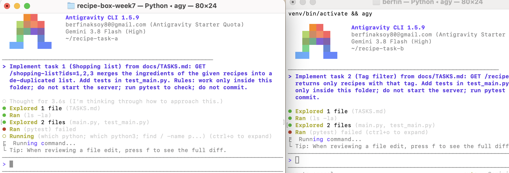

# Week 7 Writeup — Agent Orchestration: The Recipe Box Sprint

**Agents:** Antigravity CLI (`agy`, Gemini 3.8 Flash) in separate terminal windows; Gemini CLI was tried as a fallback when the Antigravity quota ran out.
**Repository:** https://github.com/berfinaksoyy/recipe-box-week7

| Part | Task(s) | Branch / worktree | Result |
|---|---|---|---|
| I — concurrent agents | 1 Shopping list, 2 Tag filter | `task-a` → `../recipe-task-a`, `task-b` → `../recipe-task-b` | both merged into `main` ([`289e032`](https://github.com/berfinaksoyy/recipe-box-week7/commit/289e032)) |
| II — generator–critic | 3 Ingredient scaling | `task-c` → `../recipe-task-c` | 4 critic rounds, 3 generator commits (2 revision rounds) |

---

## 1. Part I — Concurrency notes

**Setup**
```bash
git worktree add ../recipe-task-a -b task-a    # agent A: shopping list
git worktree add ../recipe-task-b -b task-b    # agent B: tag filter
# two terminal windows, started at the same time:
cd ~/recipe-task-a && agy      # window A
cd ~/recipe-task-b && agy      # window B
```
Both prompts ended with the same rules: *"work only inside this folder; do not start the server; run pytest to check; do not commit."*



**How collisions were avoided**
- **Files:** each agent had its own working directory, so neither could overwrite the other's unsaved edits.
- **Database:** `DB_PATH` is relative to the code folder, so each worktree had its own `recipes.db`; the tests of one agent could not see the other's data.
- **Port:** agents were told not to start the server, so two `uvicorn` processes could not fight over port 8000.
- **Git:** agents were told not to commit; I committed each branch myself, then merged one at a time.

**Collisions and risks that still happened**
- **Merge conflict:** both agents appended their tests at the end of `test_main.py`. Merging `task-b` was a fast-forward; merging `task-a` then failed with `CONFLICT (content): Merge conflict in test_main.py` ([excerpt](docs/evidence/merge-conflict-excerpt.txt)). It was resolved by keeping both test blocks; 9 tests passed after the merge. `main.py` merged automatically because agent A added a new function at the end while agent B changed `list_recipes` in the middle.
- **Shared environment:** both agents first failed to run `pytest` because their shells did not have the project's virtualenv active, and both started searching the disk for Python. Pointing them to `~/recipe-box-week7/.venv/bin/python -m pytest` fixed it. Concurrency multiplies this kind of setup problem.
- **Rate limits:** two agents use quota twice as fast. The Antigravity quota ran out during Part II (see section 2).

## 2. Part II — Generator–critic loop (Task 3, ingredient scaling)

**Roles**
- **Generator:** `agy` in normal mode, allowed to edit files and run tests, never to commit.
- **Critic:** `agy --mode plan -p "…"` — plan mode plus *"do not run any commands and do not edit any file; only read files."* Its output was saved with `| tee docs/transcripts/critic-roundN.md`.
- **Rubric:** [`docs/RUBRIC.md`](docs/RUBRIC.md) — correctness, tests, clarity, each PASS/FAIL, ending in `VERDICT: APPROVE` or `VERDICT: REVISE` + numbered list.

**Rounds** (full text in [`docs/transcripts/`](docs/transcripts))

| Round | Who | Outcome | Evidence |
|---|---|---|---|
| 0 | Generator | First implementation: integers, decimals, fractions, factor validation, 404 | [`4d057de`](https://github.com/berfinaksoyy/recipe-box-week7/commit/4d057de), [generator-round0.md](docs/transcripts/generator-round0.md) |
| 1 | Critic | **REVISE** — tests only checked status codes; no tests for `factor=0.5`, `nan`/`inf`, mixed fractions via the endpoint; import inside a test. Also noted `"70% chocolate"` → `"140%"` and `"1-2 tsp"` → `"2-2 tsp"` | [critic-round1.md](docs/transcripts/critic-round1.md) |
| 1 | Generator | **Revision 1:** exact-value assertions, new tests, percentages kept, ranges scale both bounds | [`287377c`](https://github.com/berfinaksoyy/recipe-box-week7/commit/287377c), [generator-round1.md](docs/transcripts/generator-round1.md) |
| 2 | Critic | **APPROVE** | [critic-round2.md](docs/transcripts/critic-round2.md) |
| 3 | Critic ("fresh eyes") | **REVISE** — `factor=1e308` overflows to infinity and `int(inf)` crashes the endpoint with **HTTP 500**; tiny factors round to `"0"`; en-dash ranges, `½`, `"1-1/2"` and `"1st batch"` handled wrongly | [critic-round3.md](docs/transcripts/critic-round3.md) |
| 2 | Generator | **Revision 2:** overflow → 400, small values kept, unicode dashes/fractions, ordinals, tests for each | [`446d313`](https://github.com/berfinaksoyy/recipe-box-week7/commit/446d313), [generator-round2.md](docs/transcripts/generator-round2.md) |
| 4 | Critic | **REVISE** — the round-2 fix introduced two **regressions**: `"1 - 1 1/2 cups"` no longer scales its upper bound, and superscripts like `²` become `"2/1"` | [critic-round4.md](docs/transcripts/critic-round4.md) |
| 3 | Generator | Not run — Antigravity returned *"Individual quota reached… resets in 165h"*. Gemini CLI as a fallback hit 401 (bad key paste), then 503, then the free-tier limit (20 requests/day). | [screenshot](docs/evidence/quota-reached.png) |

**Why there was a round 3 after an approval:** the round-2 critic approved after only checking its own earlier list. A second critic with an adversarial prompt ("trace by hand with extreme and unusual inputs") immediately found a server crash that every existing test missed. One approval from one critic was not enough evidence.

**Final state:** 2 revision rounds completed and evidenced; the last verdict is **REVISE** with 2 open items (mixed-number upper bound in ranges, superscript normalization). These are documented as known limitations instead of being hidden. The loop was capped at 5 critic rounds so it could not run forever.

## 3. Autonomy levels and supervision

| Agent | Autonomy | Supervision |
|---|---|---|
| Part I agents A and B | `agy` ran in **auto** mode (its default here): edits and commands without asking | Scope rules in the prompt; isolated worktrees; no commit or server rights; I reviewed each diff, committed and merged myself |
| Generator (Part II) | auto mode: edit files and run tests | No commits — every round was committed by me so each revision is a separate, reviewable commit |
| Critic (Part II) | **lowest**: plan mode, headless, no commands, no edits | Output captured to a file; a first attempt failed because headless mode auto-denied a command — the read-only rule was then made explicit in the prompt |
| Loop | — | Human decided when to start a new round, rewrote the critic prompt when it approved too early, and capped the loop at 5 rounds |

## 4. What I learned
In this assignment I learned that when several agents work at the same time, the most important part is still the person who merges their work: the agents wrote the code, but I committed and merged it, so the final check stayed with me. What surprised me most was how quickly the free quota ran out once two agents and many review rounds were running. Because of this, I think all agents should have limited permissions and ask before acting, even if that is slower, because the human has to stay in control of what gets merged.
